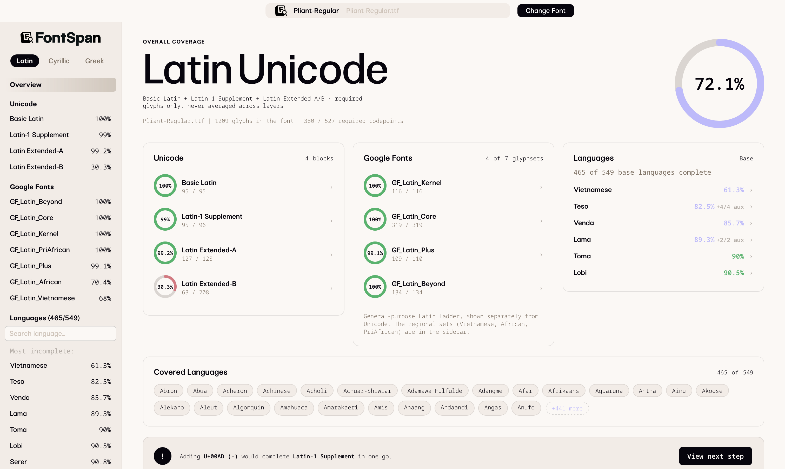
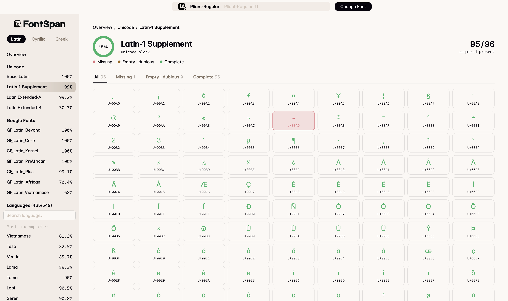
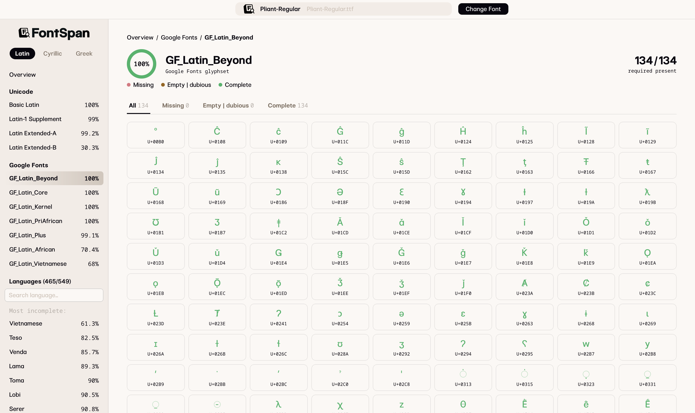
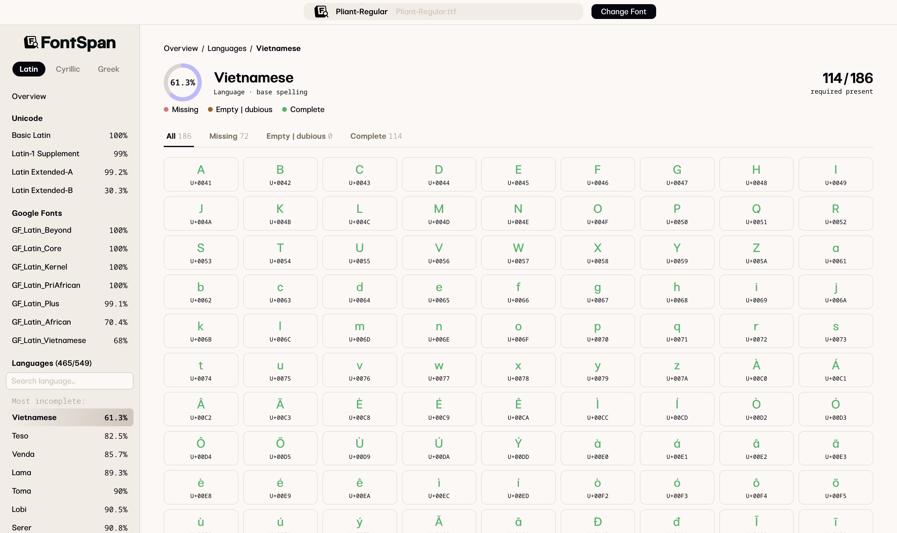
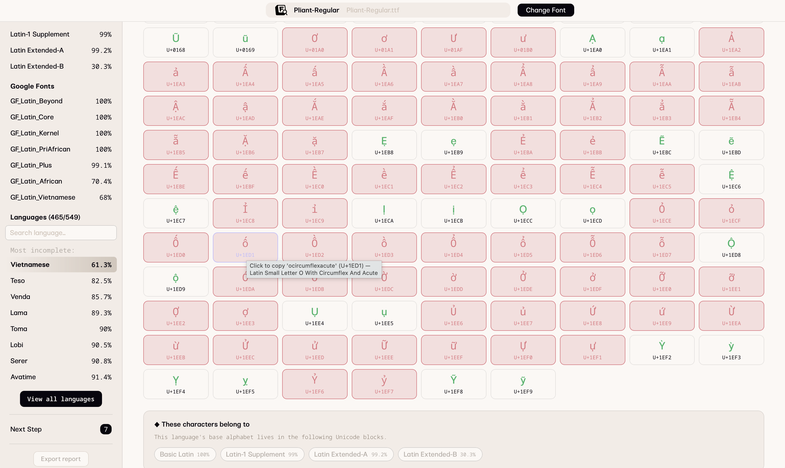
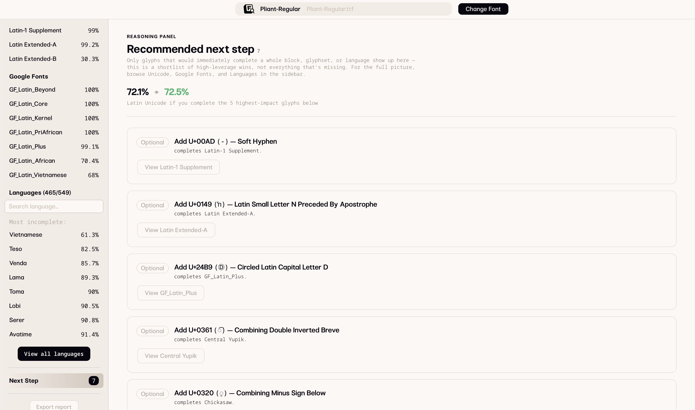
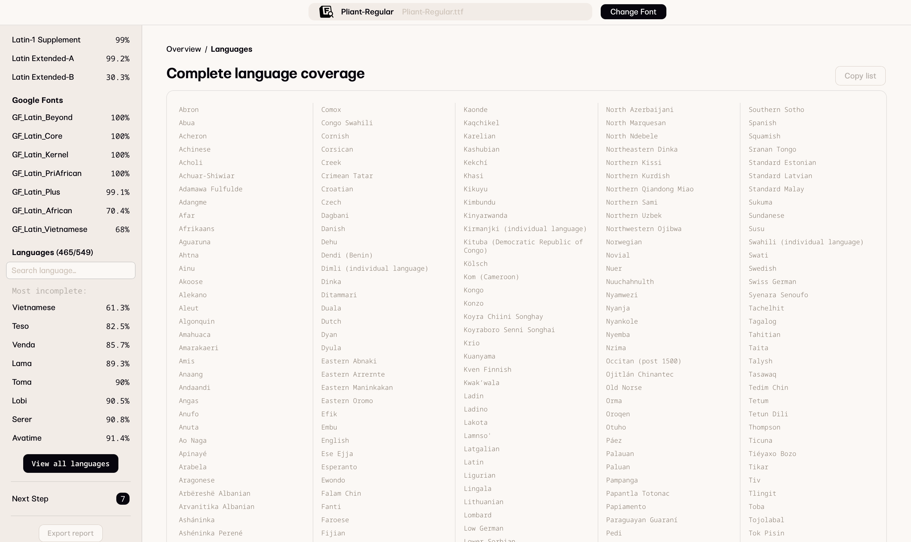
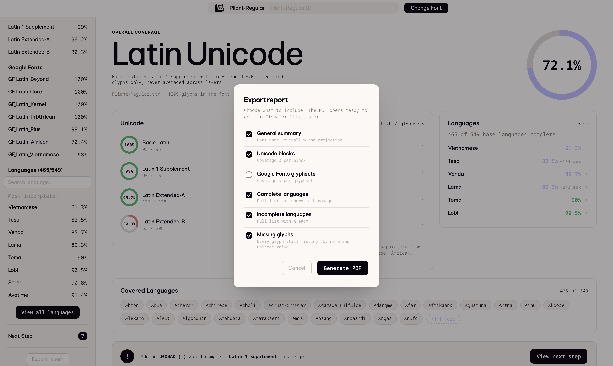

# FontSpan

Font coverage analysis for type designers, built by Non Foundry.
   

## What it does

FontSpan reads a `.ttf`, `.otf`, or `.glyphs` file and checks it against
three coverage layers: Unicode blocks, Google Fonts glyphsets, and
language coverage (Latin, Cyrillic, and Greek, via Hyperglot data). It
cross-references all three to show what's actually missing and what to
draw next, instead of reporting each layer on its own.

For `.glyphs` files, FontSpan copies the correct Glyphs name for a
missing glyph to your clipboard, so you can switch to Glyphs and find
the right slot without looking it up.

## What's new in v1.1

- View the full list of languages your font covers completely, alongside
  the ones still incomplete (previously only the incomplete list was
  visible).
- Export Report: generate a PDF summary of your font's coverage that
  you can share or keep for reference.

See [CHANGELOG.md](CHANGELOG.md) for the full version history.

## Supported

- Formats: .ttf, .otf, .glyphs
- Scripts: Latin, Cyrillic, Greek
- Platform: macOS

## Get FontSpan

One-time purchase, no subscription. A 15-day trial is available and
doesn't require a card.

fontspan.app

## Screenshots

**01. Unicode**
   

**02. Google Fonts Glyphsets**
   

**03. Languages**
   

**04. Missing Glyphs**
   

**05. Next Steps**
   

**06. Full List of Languages**
   

**07. Export Report**
   

## Found a bug or have an idea?

Open an issue here, for a bug report or a feature suggestion. For
anything else, reach us at info@nonfoundry.com.

## About this repo

This repo is FontSpan's public page: what it does, what changed between
versions, and where to report problems or ask for features. FontSpan is
closed source, so there's no app code here.

Made by Non Foundry. nonfoundry.com
fontspan.app
